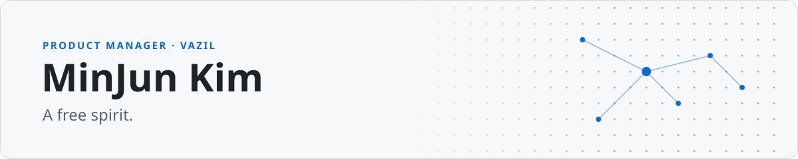

  <picture>
    <source media="(prefers-color-scheme: dark)" srcset="./assets/header-dark.svg">
    
  </picture>

I'm a product manager at **VAZIL**, where I've worked since February 2025. I work on an on-premises storage platform, from requirements and QA to release criteria, and I build team workflows on AI coding agents.

## What I do

- Define requirements and features, from screen-level specs to roadmaps and release criteria
- Run QA: test scenarios, issue triage and tracking, re-verification of fixes
- Automate browser tests and pre-release checks
- Write user guides, installation guides, and product one-pagers
- Build team workflows on AI coding agents: custom agents, skills, and review loops

## Selected work

- **On-premises data storage platform built on Lustre, a parallel distributed file system** 
  Product management: requirements, QA, documentation, release criteria, and validation plans for performance and failover.
- **Windows client for that platform** 
  Connection design review, installation and connection testing.
- **Linking a robot data collection and training platform to central storage** 
  Technical investigation of integration options and risks.
- **Ingesting data from edge devices directly into storage** 
  Technical investigation and assessment.
- **Customer ledger module for an in-house CRM** 
  Built it myself with AI coding tools and shipped it to production.
- **3D CAD modeling from mechanical drawings** 
  Automated the modeling steps through an MCP integration.

I read product code in Rust and Vue to verify behavior, and write Python for automation.

## Working with AI agents

- Several role-based agent sessions (PM assistant, debugging, development) that hand work to each other by message
- Sub-agents for research, verification, documentation, and QA, with the maker and the checker kept separate
- Scheduled headless runs that draft daily work logs and task entries, posted only after a human approves
- MCP integrations that connect agents to external tools

## Toolbox

